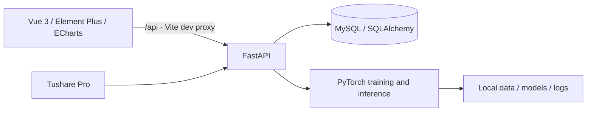

# StockAI · Deep Learning Stock Prediction System


[简体中文](README.md) · [Setup](docs/SETUP.md) · [Reproducibility](docs/REPRODUCIBILITY.md) · [Contributing](CONTRIBUTING.md) · [MIT License](LICENSE)

A graduation project and time series research platform for the Chinese A-share market. StockAI combines data collection, feature engineering, model training, prediction, evaluation and visualization in one web application. It supports **BiLSTM, Transformer and Temporal Fusion Transformer (TFT)** with **1, 3 and 5 trading-step horizons**.

For education and research. Predictions and historical simulations do not establish future returns and should not be used as investment advice.

## Features

- **Market data:** collect stock metadata and daily bars through Tushare Pro, with tasks and progress tracking.
- **Features:** moving averages, MACD, RSI, KDJ, Bollinger Bands and other indicators, plus scaling and PCA.
- **Training:** three model families, per-epoch metrics, task/model management, single- and multi-stock training scripts.
- **Evaluation:** short-term forecasts, actual-versus-predicted comparisons, MAE, RMSE, MAPE, R² and model comparisons.
- **Research views:** backtesting, feature analysis, error distributions, What-if analysis and portfolio views; consult implementations for exact behavior.
- **Dashboard:** Vue 3, Element Plus and ECharts, with configuration and logs. The application interface is primarily Chinese.

## Architecture and stack



The frontend uses Vue 3, Vite 8, Element Plus, Pinia, Vue Router and ECharts. The backend uses FastAPI, SQLAlchemy, PyTorch, pandas, NumPy, scikit-learn and ta. See [backend dependencies](backend/requirements.txt) and the [npm lockfile](frontend/package-lock.json) for versions.

## Quick start

Recommended: **Python 3.11, Node.js 22.12+ and MySQL 8.0+**. CPU execution is supported; GPU training needs compatible PyTorch/CUDA packages. Collection requires your own Tushare token and endpoint permissions.

Windows PowerShell (on macOS/Linux, activate with `source .venv/bin/activate` and copy with `cp .env.example .env`):

```powershell
git clone https://github.com/asdfg5t/StockSystem.git
cd StockSystem
python -m venv .venv
.\.venv\Scripts\Activate.ps1
python -m pip install -r backend/requirements.txt
Copy-Item .env.example .env
```

Edit the root `.env` with your MySQL credentials and Tushare token. Existing environment variables take precedence. Start MySQL, then initialize and run the backend:

```sh
cd backend
python startup.py initdb
python -m uvicorn app.main:app --host 127.0.0.1 --port 8000
```

In a second terminal, starting at the repository root:

```sh
cd frontend
npm ci
npm run dev
```

Open the [dashboard](http://localhost:5173), [Swagger API](http://127.0.0.1:8000/docs) or [ReDoc](http://127.0.0.1:8000/redoc). Initialization needs database/table creation privileges. Starting the API alone does not create all business tables. See [SETUP.md](docs/SETUP.md) for configuration and troubleshooting.

## Demo workflow

1. Collect stock metadata and the required daily bars. Start small; timing depends on provider quotas.
2. Compute indicators and inspect data quality.
3. Create a task with a stock, model, lookback and horizon; verify with a small epoch count first.
4. Review curves and held-out metrics, comparing models on matching splits.
5. Run predictions and inspect forecast/trend views.

Optional commands inside `backend`:

```sh
python startup.py collect
python startup.py train 000001.SZ
python startup.py predict 000001.SZ
```

Collection consumes API quota and training consumes compute. `reset_and_collect.py` clears existing data; `cleanup_old_models.py` deletes old models. Read these scripts and back up data before use. They are not required for initial setup.

## Repository layout

```text
StockSystem/
├── backend/
│   ├── app/
│   │   ├── api/               # Data, training, prediction and analysis APIs
│   │   ├── core/              # Time series processing and PCA
│   │   ├── dl_models/         # BiLSTM / Transformer / TFT
│   │   ├── models/            # ORM and request/response schemas
│   │   └── services/          # Collection, features, training and inference
│   ├── sql/init.sql           # Schema and default records
│   ├── tests/                 # Configuration regression checks
│   ├── startup.py             # CLI entry point
│   └── requirements.txt
├── frontend/                  # Vue application and npm lockfile
├── image/                     # Research and model diagrams
├── docs/                      # Setup and experiment guidance
├── .github/                   # CI, issue and pull request templates
├── .env.example               # Credential-free configuration template
└── LICENSE
```

`data/`, `saved_models/` and `logs/` are created at runtime. Local data, database contents, pretrained weights, experiment outputs, personal thesis files and dependencies are excluded. Collect data and train after cloning. Pair weights with their matching scalers, PCA/feature artifacts and database records.

## Experiments and limitations

The main processor includes chronological splits, training-only scaling/PCA fitting, return targets and price reconstruction. Scripts may differ in feature selection, splitting and artifact formats; check compatibility before combining outputs. There is no universal accuracy guarantee, and local results do not establish performance in a new environment.

Record the data period, stock universe, split dates, seeds, hyperparameters, hardware and dependencies. Compare with simple baselines. See [REPRODUCIBILITY.md](docs/REPRODUCIBILITY.md).

APIs currently lack authentication and are intended for local demos. Configuration page database records do not automatically override collector environment settings. Edit `.env` and restart the backend to change the token. Read [SECURITY.md](SECURITY.md) before public deployment.

## Checks and contributions

```sh
python -m compileall -q backend
python -m unittest discover -s backend/tests -v
cd frontend
npm ci
npm run build
```

GitHub Actions checks Python syntax, configuration tests and the frontend build. It does not collect live data, run database integration checks or train full models. Report bugs through [Issues](https://github.com/asdfg5t/StockSystem/issues); see [CONTRIBUTING.md](CONTRIBUTING.md).

## License and acknowledgments

Code is released under the [MIT License](LICENSE), copyright © 2026 asdfg5t. Third-party libraries retain their licenses. Market data and API use/redistribution remain subject to provider terms; this license does not grant third-party data redistribution rights. Thanks to Vue, FastAPI, PyTorch, Tushare and the supporting open-source ecosystem.
