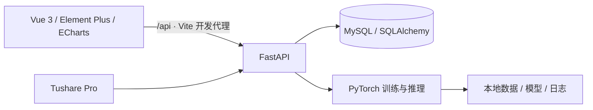

# StockAI · 基于深度学习的股票预测系统


[English](README.en.md) · [部署指南](docs/SETUP.md) · [研究复现](docs/REPRODUCIBILITY.md) · [贡献指南](CONTRIBUTING.md) · [MIT License](LICENSE)

面向中国 A 股的毕业设计与时间序列研究平台，将数据采集、特征工程、模型训练、预测评估和可视化整合到一个 Web 应用。支持 **BiLSTM、Transformer、Temporal Fusion Transformer（TFT）** 和 **1 / 3 / 5 个交易步长**实验。

本项目用于教学与研究，预测结果和历史模拟不代表未来收益，不应作为投资依据。

## 核心功能

- **数据采集**：通过 Tushare Pro 获取股票基础信息、日线行情，管理采集任务及进度。
- **特征工程**：均线、MACD、RSI、KDJ、布林带等指标，配套标准化与 PCA 处理。
- **模型训练**：三类深度学习模型、逐轮指标、训练任务和模型文件管理，以及单股、多股训练脚本。
- **预测评估**：短期预测、实际值对比、MAE / RMSE / MAPE / R² 等指标与模型比较。
- **研究分析**：回测、特征分析、误差分布、What-if 分析与组合视图，具体行为以接口实现为准。
- **可视化管理**：Vue 3 管理界面、ECharts 图表、配置与日志查看。

## 架构与技术



前端使用 Vue 3、Vite 8、Element Plus、Pinia、Vue Router 和 ECharts；后端使用 FastAPI、SQLAlchemy、PyTorch、pandas、NumPy、scikit-learn 与 ta。具体版本见 [后端依赖](backend/requirements.txt) 和 [前端锁文件](frontend/package-lock.json)。

## 快速开始

建议使用 **Python 3.11、Node.js 22.12+、MySQL 8.0+**。支持 CPU；GPU 需要兼容的 PyTorch/CUDA。采集需要自己的 Tushare Token 及接口权限。

以下为 Windows PowerShell 示例。macOS/Linux 使用 `source .venv/bin/activate` 激活，并使用 `cp .env.example .env` 复制配置。

```powershell
git clone https://github.com/asdfg5t/StockSystem.git
cd StockSystem
python -m venv .venv
.\.venv\Scripts\Activate.ps1
python -m pip install -r backend/requirements.txt
Copy-Item .env.example .env
```

编辑根目录 `.env`，填写 MySQL 密码与 Tushare Token，启动 MySQL。已有进程环境变量优先于 `.env`。

```powershell
cd backend
python startup.py initdb
python -m uvicorn app.main:app --host 127.0.0.1 --port 8000
```

另开终端，从项目根目录启动前端：

```powershell
cd frontend
npm ci
npm run dev
```

访问 [前端页面](http://localhost:5173)、[Swagger API](http://127.0.0.1:8000/docs) 或 [ReDoc](http://127.0.0.1:8000/redoc)。初始化账号需有建库建表权限；仅启动 API 不会创建全部业务表。配置与排错见 [部署指南](docs/SETUP.md)。

## 演示流程

1. 先采集股票基础信息，再采集所需日线。首次建议小范围演示，耗时取决于接口额度。
2. 计算技术指标并检查数据质量。
3. 创建训练任务，选择股票、模型、窗口与步长；先用少量轮数验证流程。
4. 查看训练曲线和评估，在相同数据划分下比较模型。
5. 使用训练好的模型进行预测，查看结果和走势。

可在 `backend` 目录运行：

```sh
python startup.py collect
python startup.py train 000001.SZ
python startup.py predict 000001.SZ
```

采集消耗接口额度，训练消耗计算资源。`reset_and_collect.py` 清空已有数据；`cleanup_old_models.py` 删除旧模型。使用维护脚本前请阅读代码并备份，它们不属于首次启动必需步骤。

## 项目结构

```text
StockSystem/
├── backend/
│   ├── app/
│   │   ├── api/               # 数据、训练、预测、评估与分析接口
│   │   ├── core/              # 时间序列处理与 PCA
│   │   ├── dl_models/         # BiLSTM / Transformer / TFT
│   │   ├── models/            # ORM 与请求/响应模型
│   │   └── services/          # 数据、特征、训练及推理服务
│   ├── sql/init.sql           # 数据库结构与默认记录
│   ├── tests/                 # 配置回归检查
│   ├── startup.py             # CLI 入口
│   └── requirements.txt
├── frontend/                  # Vue 界面与 npm 锁文件
├── image/                     # 研究与模型示意图
├── docs/                      # 部署与实验复现
├── .github/                   # CI、Issue 与 PR 模板
├── .env.example               # 不含真实凭据的配置示例
└── LICENSE
```

运行时创建 `data/`、`saved_models/` 和 `logs/`。仓库不包含本地行情、数据库、预训练权重、实验结果、个人论文和依赖目录，克隆后需自行采集并训练。权重应与对应标准化器、PCA/特征文件及数据库记录配套使用。

## 实验与边界

主处理器包含时间顺序划分、训练集拟合标准化器及 PCA、收益率目标与价格还原。不同脚本的特征选择、划分及产物格式可能不同，不应直接混用。项目不承诺统一准确率，本地实验结果不作为其他环境的性能保证。

复现时记录数据范围、股票集合、划分日期、种子、参数、硬件与依赖，并与简单基线比较。详见 [研究复现](docs/REPRODUCIBILITY.md)。

目前 API 尚无登录认证，适用于本地演示。配置页的数据库记录不会自动覆盖采集器读取的环境配置；更改 Token 应编辑 `.env` 并重启后端。公开部署前阅读 [安全说明](SECURITY.md)。

## 检查与协作

```sh
python -m compileall -q backend
python -m unittest discover -s backend/tests -v
cd frontend
npm ci
npm run build
```

GitHub Actions 检查 Python 语法、配置测试和前端构建，不执行真实采集、数据库集成或完整训练。欢迎提交 [Issue](https://github.com/asdfg5t/StockSystem/issues)，贡献流程见 [CONTRIBUTING.md](CONTRIBUTING.md)。

## 许可证与致谢

代码采用 [MIT License](LICENSE)，版权所有 © 2026 asdfg5t。第三方库保留自身许可证；行情及接口使用与再分发遵循提供方条款，本许可证不授予第三方数据再分发权。感谢 Vue、FastAPI、PyTorch、Tushare 及相关开源项目。
